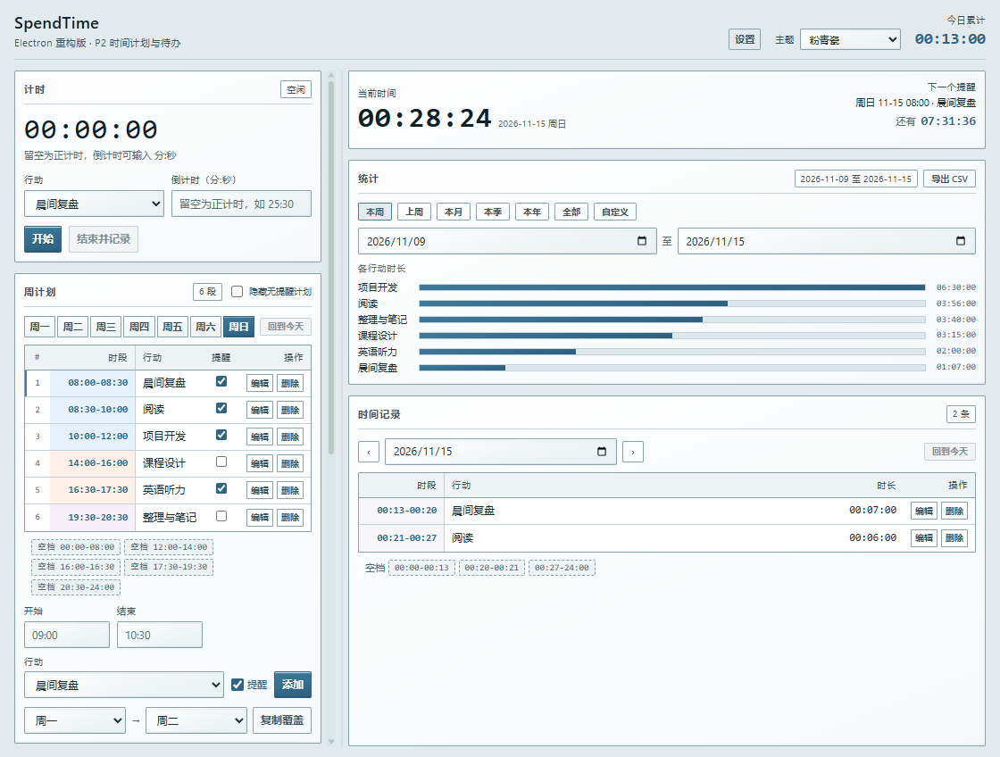
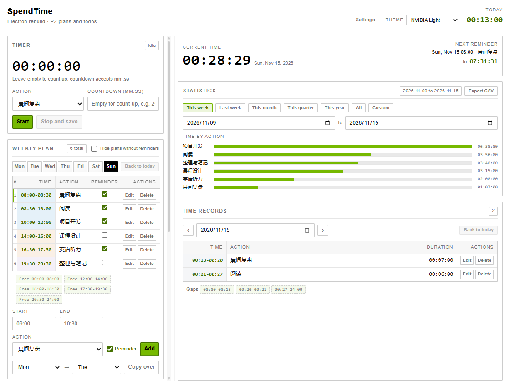

# SpendTime-Electron

自用时间管理小工具SpendTime的Electron重构版，有计时，待办，闹钟，统计用时等功能。time plan | todo | time records | clock | timer

技术栈：Electron 45 + React 19 + TypeScript + Vite（electron-vite）+ better-sqlite3 + Zod。

## 界面



粉青瓷浅色主题：计时、周计划、统计与每日时间记录。




NVIDIA 浅色主题，英文界面。

## 安装与运行

要求 Node.js 22 及以上。

```bash
npm install
npm run dev
```

如果 `npm install` 在 better-sqlite3 上触发 `node-gyp` 且本机没有 C++ 工具链，可改用 `npm install --ignore-scripts`；如果 Electron 二进制没有随安装自动下载，再执行 `node node_modules/electron/install.js` 补齐。

## 构建与打包

```bash
npm run build      # 类型检查并构建到 out/
npm run package    # 生成图标、构建并打包到 release/
```

打包产物未配置代码签名，Windows 可能提示“未知发布者”。

## 数据存放

- 开发模式：仓库内的 `.devdata/`。
- 安装版：`%APPDATA%\SpendTime`。
- 数据库：`data/spendtime.db`；启动和手动备份位于 `data/backups/`，可在设置中恢复。

## 许可证

本项目使用 **AGPL-3.0**（GNU Affero General Public License v3.0）。修改后分发，或把修改版作为网络服务提供，都必须以同一许可证开放源代码。完整条款见 [LICENSE](LICENSE)。

## 关于开发方式

本项目开发过程依赖 vibe coding，使用Trea制作，主要使用Kimi 与 DeepSeek 模型；

